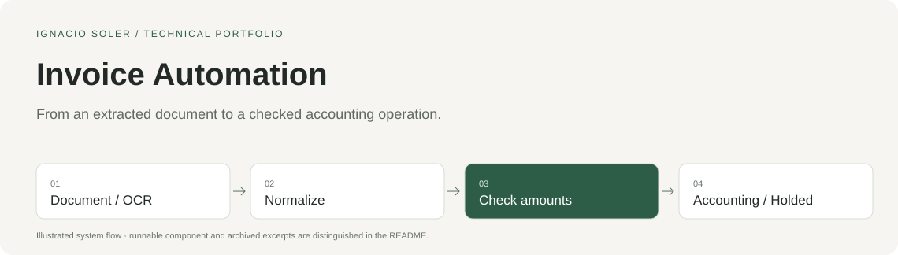

# Invoice Automation

From an extracted document to a checked accounting operation.

[Run the sample](#run-the-sample) · [Architecture](docs/architecture.md) · [Design decisions](docs/decisions.md) · [Code tour](docs/code-tour.md) · [Español](docs/LEEME.md)



## The project

Reading an invoice is only the first step. Extracted amounts, tax rates, supplier information and accounting mappings must remain coherent before a document reaches the accounting system.

**My work.** I built the flow from OCR and normalization to financial validation, supplier/account mapping and preparation for Holded registration and reconciliation. Bank-description matching used historical descriptions, embeddings and cosine similarity. I led the product and technical construction, using AI-assisted development alongside integration and verification.

**Period.** Built in 2024–2025; remains active as of October 2026.

**Current use.** The automation remains active: **two restaurants use it recurrently every month** for their invoice-processing workflows.

Usage status reported by the founder on 15 October 2026. Invoice volumes and time savings have not been quantified.

## What you can inspect here

This repository runs the original line-level tax and total checks. The OCR, BigQuery and Holded integrations are documented through selected source excerpts; they are not connected by the demo.

| Entry | What to look at |
|---|---|
| [invoice_controls.py](source/invoice_controls.py) | Original executable component |
| [demo.py](demo.py) | Synthetic fixtures and 5 checked behaviors |
| [Architecture](docs/architecture.md) | The wider system and the sample boundary |
| [Design decisions](docs/decisions.md) | Tradeoffs with source links |
| [Code tour](docs/code-tour.md) | 5 selected excerpts from the wider construction |
| [Provenance](provenance.json) | Original paths, commits, hashes and documented redactions |

## Run the sample

Requires **Python 3.10+**, with no package installation or account setup.

```sh
git clone https://github.com/nasoler123/invoice-automation.git
cd invoice-automation
python3 -I demo.py
python3 verify.py
```

The sample runs offline with synthetic data; it rejects socket operations and external subprocesses. `verify.py` checks the result receipt, source hash, local links, instruction parity and credential patterns. These checks cover the published sample rather than the full production system.

Expected observations:

- A coherent line passes.
- Incorrect VAT, an incorrect total and missing fields fail with different reasons.
- Zero amounts are valid inputs.

[Recorded local results](verification.json).

## Stack in context

Python · Google Document AI · Azure Document Intelligence · BigQuery · Holded · embeddings.

The stack describes the wider construction. The executable sample uses Python's standard library; the remaining integrations appear in the code tour.

## Related work

This case belongs to the evolution of **Chals AI**, from document automation and a financial product to agent tooling and managed data infrastructure. The cases overlap; they are not four separate companies.

[Financial Modeling SaaS](https://github.com/nasoler123/financial-modeling-saas) · [AI Agent Harness](https://github.com/nasoler123/ai-agent-harness) · [Data Platform and MCP](https://github.com/nasoler123/data-platform-mcp)

[Ignacio Soler](https://github.com/nasoler123) · [LinkedIn](https://www.linkedin.com/in/ignacio-soler-esteban/)
