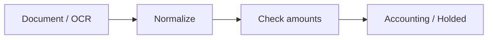

# Architecture

[Project](../README.md) · [Design decisions](decisions.md) · [Code tour](code-tour.md)

## System built

I built the flow from OCR and normalization to financial validation, supplier/account mapping and preparation for Holded registration and reconciliation. Bank-description matching used historical descriptions, embeddings and cosine similarity.

## Runnable boundary

This repository runs the original line-level tax and total checks. The OCR, BigQuery and Holded integrations are documented through selected source excerpts; they are not connected by the demo.

The local route is `synthetic fixture → original component → checked result`. [Read the component](../source/invoice_controls.py) and [run the fixture](../demo.py). The network is blocked before the component is imported.

## External dependencies of the full system

Python · Google Document AI · Azure Document Intelligence · BigQuery · Holded · embeddings. The original product connects these components through shared runtime and account context. This repository preserves selected examples and a bounded local demonstration.
